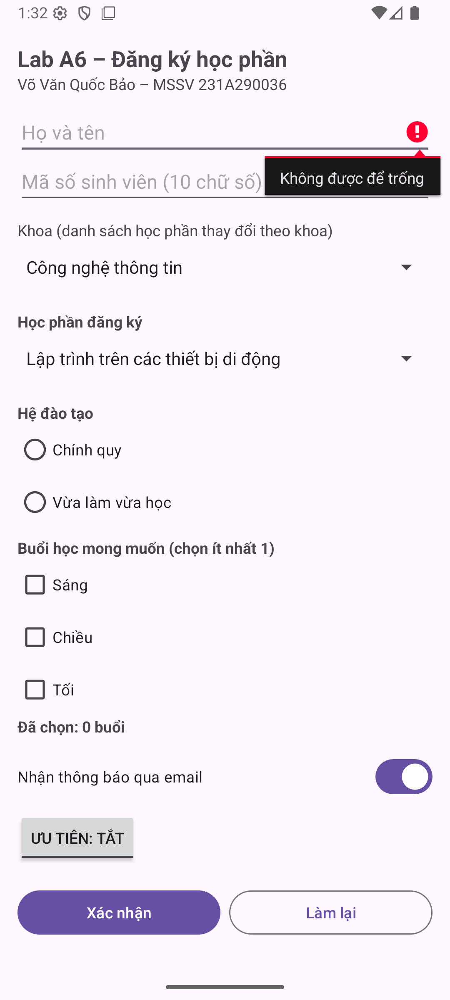
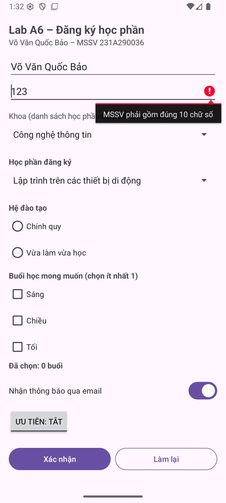
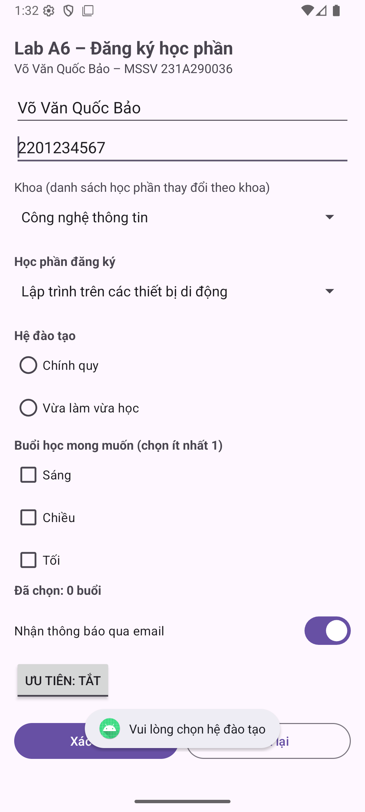
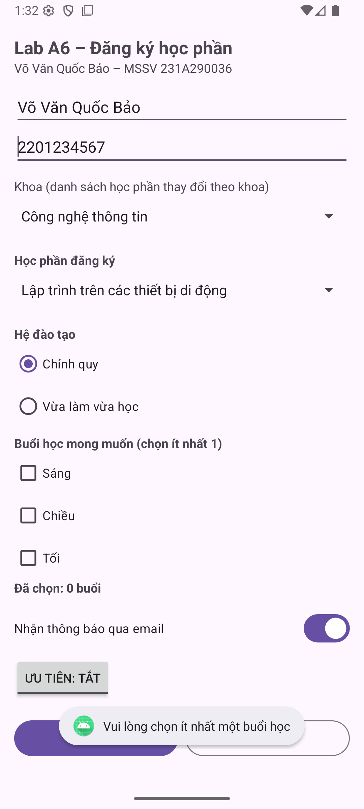
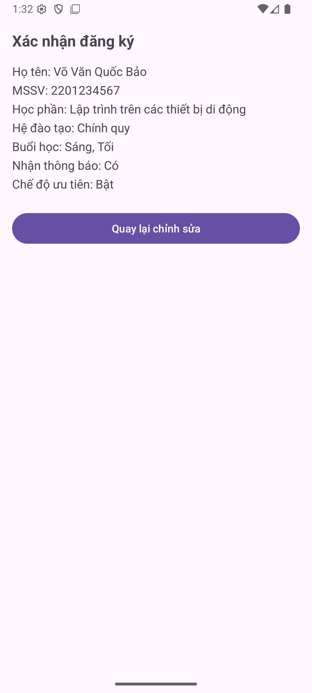
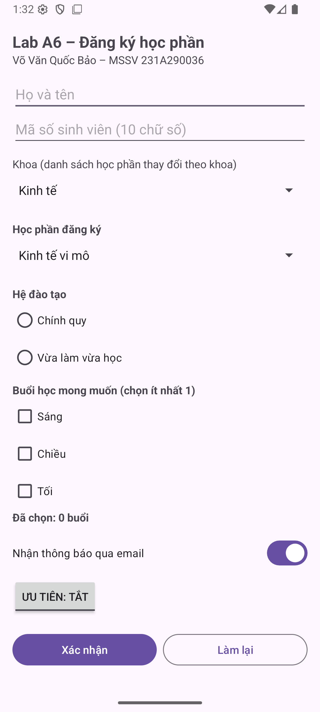

# BÁO CÁO LAB A6 - Controls lựa chọn và ứng dụng đăng ký học phần
Họ tên: Võ Văn Quốc Bảo  |  MSSV: 231A290036

Học phần: INT4211 - Lập trình trên các thiết bị di động. Ngày kiểm chứng: 20/10/2026.

Repository: https://github.com/VOVANQUOCBAO/A6_231A290036

## 1. Giao diện và quy tắc dữ liệu

Form có EditText, CheckBox, RadioGroup/RadioButton, MaterialSwitch, ToggleButton và Spinner trong ScrollView. ArrayAdapter lấy dữ liệu học phần từ arrays.xml. ConfirmActivity nhận chuỗi tóm tắt 7 dòng qua Intent.

MSSV người nộp là 231A290036. Riêng ô MSSV của bài tập được kiểm tra đúng 10 chữ số theo đề; dữ liệu hợp lệ trong demo là 2201234567. Chuỗi 231A290036 bị từ chối có chủ đích vì chứa chữ A. Không thay đổi quy tắc của đề để hợp thức hóa dữ liệu.

## 2. Bảng 8 kịch bản đã chạy

| # | Thao tác | Kết quả thực tế |
| --- | --- | --- |
| 1 | Bỏ trống họ tên | Đạt: setError tại tên, requestFocus; không mở Confirm. |
| 2 | MSSV = 123 | Đạt: báo phải gồm đúng 10 chữ số. |
| 3 | Chưa chọn hệ đào tạo | Đạt: Toast nhắc chọn hệ, vẫn ở form. |
| 4 | Chưa chọn buổi nào | Đạt: Toast nhắc chọn ít nhất một buổi. |
| 5 | Điền tên, 2201234567, hệ chính quy; Sáng và Tối | Đạt: Confirm hiện đúng 7 dòng, thông báo Có, ưu tiên Bật. |
| 6 | Bấm Làm lại | Đạt: xóa tên/MSSV/lỗi; Spinner đầu; bỏ radio/checkbox; switch Có; ưu tiên Tắt. |
| 7 | Xoay màn hình khi nhập dở | Đạt: tên/MSSV, radio, checkbox, switch/toggle và lựa chọn Spinner được giữ. |
| 8 | Back từ Confirm | Đạt: trở về form và giữ dữ liệu đã nhập. |

---

## 3. Bốn trường hợp báo lỗi

---

## 4. Xác nhận và phần nâng cao

NC1: Spinner Khoa lấy từ arrays.xml; khi đổi khoa, OnItemSelectedListener thay ArrayAdapter của Spinner Học phần bằng mảng tương ứng. Lưu cả khoa và chỉ số môn trong Bundle để phục hồi khi xoay.

NC2: cả 3 CheckBox dùng chung OnCheckedChangeListener; đếm số ô isChecked và cập nhật TextView ngay sau mỗi thay đổi, sau phục hồi trạng thái và khi Làm lại. Kiểm thử chọn Sáng + Tối cho kết quả 2 buổi.

---

## 5. Trả lời 3 câu hỏi phân tích

1. EditText có id được Android tự lưu trạng thái. Các control có id trong bài này cũng phục hồi trạng thái lựa chọn. Spinner phụ thuộc được lưu thêm khoa/môn để việc tạo lại adapter không ghi đè lựa chọn; bộ đếm được tính lại từ CheckBox.

2. Nếu bỏ ScrollView, các nút phía dưới có thể nằm ngoài màn hình nhỏ hoặc bị bàn phím che, người dùng không thể cuộn để bấm Xác nhận. Cả form và màn hình xác nhận đều cho phép cuộn.

3. RadioGroup.clearCheck bỏ mọi RadioButton, trả id = -1. Spinner không có cùng cơ chế này; setSelection(0) đưa về mục đầu tiên, là trạng thái mặc định của danh sách.

## 6. Đối chiếu với Flutter - Lab F3

| Việc cần làm | Android Java + XML | Flutter Dart |
| --- | --- | --- |
| Ô nhập chữ | EditText + setError | TextFormField + validator |
| Chọn nhiều | CheckBox.isChecked() | CheckboxListTile + biến bool |
| Chọn một, ít phương án | RadioGroup + RadioButton | RadioGroup + Radio |
| Chọn một, danh sách dài | Spinner + ArrayAdapter | DropdownButtonFormField |
| Bật/tắt | MaterialSwitch | SwitchListTile |
| Kiểm tra cả form | Các if theo thứ tự, return sớm | FormState.validate() qua GlobalKey |

Flutter tập trung kiểm tra qua Form/validator; bản Android này kiểm tra từng bước nên cần tự tổ chức thông báo và điểm dừng. Cả hai cần lưu dữ liệu và kiểm tra nghiệp vụ phù hợp. Bảng so sánh theo yêu cầu tài liệu, không khẳng định đã xây dựng một project Flutter.

---

## 7. Trả lời 5 câu hỏi ôn tập

1. CheckBox dùng cho nhiều lựa chọn độc lập; RadioGroup dùng chọn một trong ít phương án hiện sẵn; Spinner dùng chọn một trong danh sách dài.

2. ArrayAdapter nối dữ liệu mảng/danh sách với các View hiển thị cho Spinner; nó tạo dòng đang chọn và các dòng trong danh sách xổ xuống.

3. OnItemSelectedListener có hai phương thức trừu tượng: onItemSelected và onNothingSelected nên không phải functional interface, không viết được bằng một lambda.

4. getCheckedRadioButtonId trả -1 khi chưa chọn hoặc sau clearCheck.

5. Kiểm tra theo thứ tự: tên sau trim không rỗng → MSSV khớp [0-9]{10} → đã chọn hệ đào tạo → có ít nhất một buổi học → lấy học phần, switch, toggle → định dạng 7 dòng và chuyển sang Confirm.

## Môi trường và phạm vi kiểm chứng

Project Java + XML; minSdk 24, targetSdk/compileSdk 35, Java 17. Android Gradle Plugin 9.0.1; Gradle Wrapper 9.1.0. Máy ảo Medium Phone, Android API 36. Bộ kiểm thử instrumentation đạt 12 phép kiểm tra trong lượt chính.

APK được build và cài thật lên máy ảo. Ảnh ứng dụng được chụp trực tiếp từ máy ảo; video quay màn hình bằng adb screenrecord. Chưa kiểm chứng trên điện thoại thật hoặc máy API 24. Nhật ký gốc và kết quả lint nằm trong KiemThu/.

## Tệp nộp và khả năng tái lập

Thư mục gốc là project mở trực tiếp bằng Android Studio. APK/ chứa bản debug có chữ ký để cài thử; BaoCao/ chứa PDF và bản Markdown có thể sửa; AnhMinhChung/ chứa ảnh gốc; Video/ chứa video demo; KiemThu/ chứa log, báo cáo lint và cách chạy lại kiểm thử.

Nguồn yêu cầu: Lab_A6_HuongDanThucHanh.pdf do người dùng cung cấp. Repository để Private. Không gửi lời mời giảng viên theo yêu cầu của chủ tài khoản.
